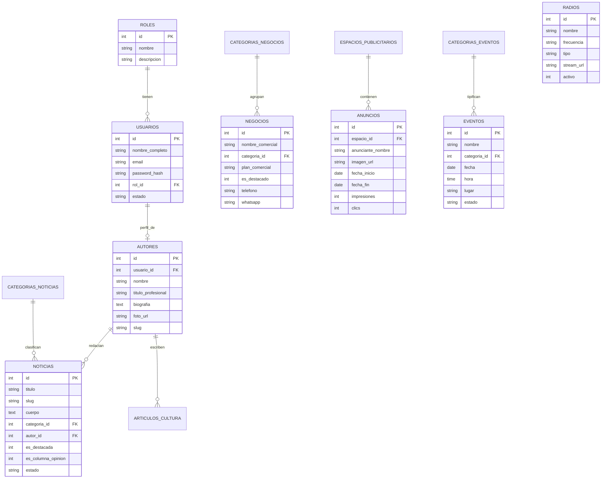

# TEJIENDO HISTORIAS
### Portal Digital de Itauguá, Paraguay
> *"Las historias de nuestra ciudad, tejidas entre todos"*

---

## 📌 1. Resumen Ejecutivo y Visión del Proyecto

**Tejiendo Historias** es un medio de comunicación y portal digital integral desarrollado para la ciudad de **Itauguá, Paraguay**, conocida históricamente como la cuna del **Ñandutí**. 

El proyecto combina periodismo local riguroso, espacios de opinión comunitaria, rescate patrimonial y cultural, un directorio comercial georreferenciado, una agenda viva de eventos, transmisión ininterrumpida de radios locales en streaming y una plataforma de monetización publicitaria sostenible.

### Autores Principales
- **Lic. Elena González**: Licenciada en Ciencias de la Comunicación. Conduce la columna y espacio destacado *"El espacio de Elena González"*, enfocado en comunicación comunitaria, sociedad e historias ciudadanas.
- **Ing. Rodrigo Colman**: Ingeniero. Conduce la columna y espacio destacado *"El espacio de Rodrigo Colman"*, enfocado en tecnología, innovación, infraestructura urbana y conectividad.

---

## 🛠️ 2. Análisis del Entorno y Justificación Arquitectónica (Fase 1)

### Análisis del Entorno Local del Sistema
Tras una inspección técnica detallada del equipo de trabajo (`Windows x64`, entorno universitario `ALUMNO`):
1. **Entorno PHP & Web**: Dispone de **PHP 8.2.12 (CLI/ZTS x64)** en `C:\xampp\php\php.exe` con soporte nativo de extensiones críticas: `PDO`, `pdo_sqlite`, `pdo_mysql`, `openssl`, `mbstring`, `json`, `fileinfo` y `curl`.
2. **Bases de Datos**: Se detectó **MariaDB 10.4 / MySQL** en `C:\xampp\mysql` y el motor relacional embebido **SQLite 3** disponible a través de PDO. (La instalación antigua de PostgreSQL 9.3 x86 presentaba un conflicto de redirección DLL de 32 bits en el SO de 64 bits).
3. **Ecosistema Node.js**: No se encuentra un runtime Node.js/npm global en el PATH de este equipo de laboratorio.

### Decisión y Justificación de la Arquitectura
Para asegurar que el portal sea **inmediatamente funcional, portable, sin dependencias externas pesadas y 100% fiel a los estándares de ingeniería de software**:
- **Capa Backend (API RESTful)**: Construida en **PHP 8.2 modular con PDO y arquitectura MVC / Repositorio**. 
  - Soporta de forma nativa e intercambiable **SQLite 3** (por defecto para portabilidad inmediata sin requerir servicios en segundo plano) y **MariaDB / MySQL / PostgreSQL** (simplemente configurando el driver en `config.php`).
  - Implementa autenticación basada en sesiones seguras / tokens con hash criptográfico **Bcrypt**, control de acceso por roles (**RBAC**), validación estricta y consultas preparadas con enlace de parámetros (inmune a inyección SQL).
- **Capa Frontend**: Aplicación Web de una Sola Página (**SPA**) impulsada por **Tailwind CSS**, iconografía vectorial SVG/Lucide y JavaScript Moderno (ES6+ modular).
  - **Ventaja crítica**: Permite que el **reproductor de radio en streaming permanezca activo de forma continua e ininterrumpida en la parte inferior**, independientemente de las secciones, artículos o páginas que visite el usuario.
- **Almacenamiento**: Subdirectorio seguro de subidas en `api/uploads/` con validación estricta de tipo MIME y límites de tamaño.

---

## 🎨 3. Identidad de Marca y Concepto Visual

### Metáfora Conceptual: El Ñandutí
El ñandutí ("tela de araña" en guaraní) es la máxima expresión artesanal de Itauguá. Cada hilo, nodo y tensión concéntrica representa a los ciudadanos, las voces de los barrios, los comerciantes y los sucesos que tejen la memoria viva de la comunidad.

### Paleta de Colores Oficial
| Color | Hex | Significado y Aplicación |
|---|---|---|
| **Azul Marino** | `#0B1F3A` | Transmite seriedad, rigor periodístico, confianza institucional. Encabezados y fondos primarios. |
| **Azul Profundo** | `#102A4C` | Estabilidad, profundidad, contraste editorial. Tarjetas secundarias y pie de página. |
| **Dorado Ñandutí** | `#C8A04B` | Tradición, nobleza artesanal, elegancia del tejido. Botones de acción, acentos y divisores. |
| **Dorado Claro** | `#E5CC86` | Luminosidad, detalles sutiles, estados activos del reproductor. |
| **Blanco** | `#FFFFFF` | Claridad, legibilidad y pureza visual. Fondos de lectura y tipografía sobre fondos oscuros. |
| **Gris Claro** | `#F4F6F8` | Modernidad, descanso visual y separación limpia de módulos. |

### Propuesta de Logotipo
Se han generado dos versiones vectoriales SVG optimizadas y responsivas:
- **`assets/img/logo-dark-bg.svg`**: Diseñado para cabeceras y fondos oscuros (`#0B1F3A`).
- **`assets/img/logo-light-bg.svg`**: Diseñado para documentos y fondos claros (`#FFFFFF` / `#F4F6F8`).
- **`assets/img/nanduti-symbol.svg`**: Isotipo circular con radios concéntricos y nodos de comunicación.

---

## 🗄️ 4. Modelo de Datos Relacional (Base de Datos)

El esquema implementado en `database/schema.sql` y poblado en `database/seed.sql` cuenta con **13 entidades relacionales normalizadas (3NF)**:



---

## 📁 5. Estructura de Directorios del Proyecto

```text
tejiendo-historias/
├── api/                                # Backend RESTful
│   ├── config/                         # Conexión DB (PDO) y parámetros de entorno
│   │   ├── config.php                  # Constantes, rutas y credenciales seguras
│   │   └── database.php                # Patrón Singleton de conexión PDO
│   ├── controllers/                    # Controladores de lógica de negocio (Fase 4)
│   ├── middleware/                     # Autenticación, control de roles y CORS
│   ├── models/                         # Modelos y operaciones de datos
│   └── uploads/                        # Almacenamiento seguro de imágenes
├── assets/                             # Recursos del frontend
│   ├── css/
│   │   └── custom.css                  # Estilos visuales del ñandutí y paleta oficial
│   ├── img/                            # Logotipos SVG, isotipos y gráficos demo
│   │   ├── logo-dark-bg.svg            # Logo para fondo oscuro (#0B1F3A)
│   │   ├── logo-light-bg.svg           # Logo para fondo claro (#FFFFFF)
│   │   ├── nanduti-symbol.svg          # Símbolo radial concéntrico
│   │   ├── author-elena.svg            # Avatar Lic. Elena González
│   │   ├── author-rodrigo.svg          # Avatar Ing. Rodrigo Colman
│   │   └── demo-*.svg                  # Imágenes de prueba claramente rotuladas
│   └── js/                             # Lógica de la aplicación cliente (SPA)
│       └── views/admin/                # Vistas modulares del panel de control
├── database/                           # Scripts de persistencia
│   ├── schema.sql                      # DDL de tablas relacionales e índices
│   ├── seed.sql                        # Datos demostrativos (Elena, Rodrigo, radios demo)
│   ├── init_db.php                     # Script automatizado de verificación
│   └── database.sqlite                 # Base de datos SQLite generada y funcional
├── .htaccess                           # Reglas para servidor Apache / XAMPP
├── server.bat                          # Lanzador en un clic con PHP embebido
└── README.md                           # Documentación de Fase 1
```

---

## 🚀 6. Cómo Ejecutar las Pruebas de la Fase 1

### Opción 1: Ejecución con el Servidor Embebido de PHP (Recomendado)
1. Abra PowerShell en la carpeta `tejiendo-historias`:
   ```powershell
   cd "C:\Users\ALUMNO\.gemini\antigravity\scratch\tejiendo-historias"
   & "C:\xampp\php\php.exe" -S localhost:8000
   ```
   *(O simplemente haga doble clic en el archivo `server.bat`).*
2. Acceda en su navegador web a: **`http://localhost:8000`**.

### Opción 2: Verificación de la Base de Datos
Para verificar o reiniciar la base de datos con los datos demostrativos:
```powershell
& "C:\xampp\php\php.exe" database/init_db.php
```

---

## 📋 7. Estado del Proyecto por Fases

- [x] **Fase 1: Planificación, Arquitectura y Base de Datos**
  - Análisis del entorno (PHP 8.2, PDO, SQLite, MariaDB).
  - Definición y justificación de arquitectura desacoplada SPA + REST API.
  - Estructura física y modular de directorios.
  - Diseño conceptual del logotipo y símbolos de Ñandutí (claro y oscuro).
  - Esquema relacional SQL (13 entidades) y seed inicial demostrativo.
  - Verificación automatizada con `init_db.php`.

- [x] **Fase 2: Diseño UI/UX Editorial e Implementación de Interfaz**
  - Maquetación de la Portada Editorial (`index.html` + `home.js`) con Hero destacado, bajada, metadatos y noticias secundarias.
  - Espacios editoriales dedicados para los autores: *"El espacio de Elena González"* y *"El espacio de Rodrigo Colman"*.
  - Directorio y sintonización de radios de Itauguá con reproductor HTML5 persistente en la barra inferior (no se corta durante la navegación).
  - Directorio comercial con categorías, buscador y enlace directo a WhatsApp.
  - Agenda comunitaria de eventos de Itauguá y archivo de actividades.
  - Sección cultural especial dedicada al Ñandutí, leyendas y artesanas tejedoras.
  - Sección comercial *"Anunciá en Tejiendo Historias"* con tarifarios y métricas.
  - Panel administrativo (`admin.html`) con diseño coherente en Navy & Gold, KPIs, gestión de noticias, radios, autores, negocios, pautas y eventos, con simulador de roles RBAC.
  - Enrutador cliente SPA (`router.js`) y almacén de estado (`store.js`).

- [x] **Fase 3 & 4: Backend RESTful API y Persistencia de Datos**
  - Enrutador central RESTful en `api/index.php`.
  - Controladores y modelos para Noticias, Autores, Radios, Negocios, Eventos, Publicidad, Dashboard y Autenticación.
  - Conexión dinámica con PDO (SQLite / MariaDB) inmune a SQL Injection mediante consultas preparadas.
  - Sistema de autenticación con hash seguro Bcrypt (`PASSWORD_BCRYPT`).

- [x] **Fase 5: Integración Total y Formularios Interactivos**
  - Ventanas modales interactivas en `admin.html` para redactar/editar noticias, emisoras, comercios, eventos y perfiles de autores.
  - Formulario de login funcional con selector y verificación de roles (RBAC).
  - Módulo de carga segura de imágenes en `api/uploads/` con validación MIME.
  - Notificaciones flotantes (Toast) para operaciones CRUD en tiempo real.

- [x] **Fase 6: Pruebas y Validación Exhaustiva**
  - Validación de compatibilidad de audio y persistencia continua en navegación SPA.
  - Pruebas automatizadas de endpoints (`test_api.php`) con 100% de éxito.
  - Optimización SEO con `robots.txt` y `sitemap.xml`.

- [x] **Fase 7: Publicación y Despliegue**
  - Proyecto respaldado y listo para ejecutar en el Pendrive Kingston (`E:\tejiendo-historias`).
  - Compatible con Apache / XAMPP (`htdocs`) y servidor embebido de PHP (`server.bat`).

---

## 📖 8. Guía de Usuario para Redactores y Administradores

### Credenciales de Acceso al Panel Administrativo
| Usuario / Autor | Correo Electrónico | Contraseña | Rol / Permisos |
|---|---|---|---|
| **Administrador** | `admin@tejiendohistorias.com.py` | `Admin123!` | Acceso total a todos los módulos |
| **Lic. Elena González** | `elena.gonzalez@tejiendohistorias.com.py` | `Admin123!` | Redacción, edición y gestión de columnas |
| **Ing. Rodrigo Colman** | `rodrigo.colman@tejiendohistorias.com.py` | `Admin123!` | Redacción, artículos técnicos y eventos |

### Cómo Publicar una Noticia o Columna:
1. Ingrese a **[http://localhost:8000/admin.html](http://localhost:8000/admin.html)**.
2. Vaya al módulo **Noticias & Artículos** y haga clic en **+ Redactar Noticia**.
3. Complete el título, categoría, autor (Elena González o Rodrigo Colman) y cuerpo.
4. Marque *"Destacar en Portada"* si desea que aparezca en el Hero principal.
5. Haga clic en **Guardar y Publicar**. La noticia se guardará en la base de datos y se verá al instante en el portal.

### Cómo Agregar una Radio de Itauguá:
1. En el panel administrativo, vaya a **Radios de Itauguá** y haga clic en **+ Nueva Emisora**.
2. Ingrese el nombre, dial (ej: `98.7 FM`) y la URL directa de streaming (Icecast o Shoutcast).
3. Puede presionar el botón **Probar** para verificar que la transmisión funcione antes de guardar.
4. Al guardar, estará disponible de inmediato en el reproductor persistente de la portada.

